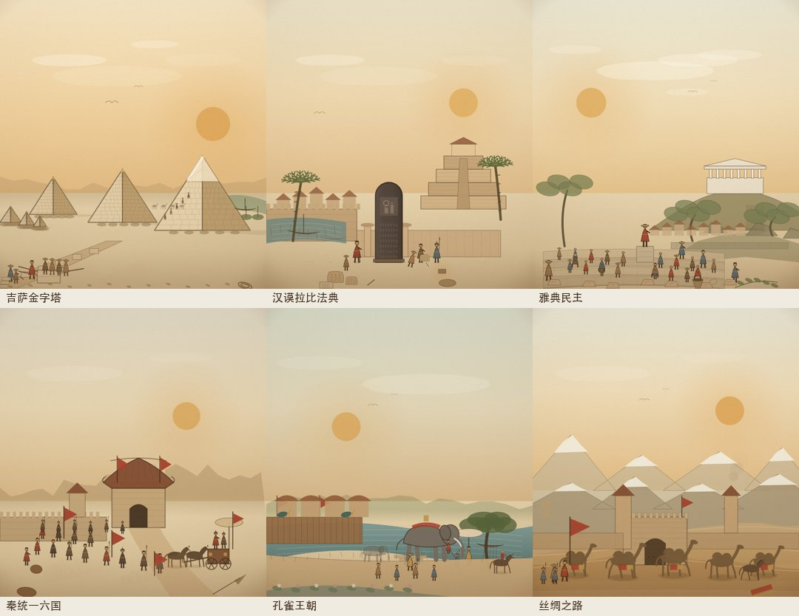

# 2A 批次复审 / Batch 2A Review

Date 2026-11-06. Scope: 6 new hero themes (6 event ids) added to the 12-theme pilot, for **18 themes / 20 event ids** total.

## 1. 本批场景

| 事件 | ID | 构图 | 主要层 |
|---|---|---|---|
| 吉萨金字塔 | `pyramids-of-giza` | 三座金字塔沿对角线，前方采石/拖运石块的施工场景；大金字塔有光滑外壳帽 | 天空/尼罗河 → 高原 → 三塔 → 坡道/石块 → 工人/尘 |
| 汉谟拉比法典 | `code-of-hammurabi` | 巴比伦庭院：黑色玄武岩石碑居中，王/法官、书吏、请愿者、泥板 | 天空 → 塔庙/城墙 → 幼发拉底河/棕榈 → 石碑 → 人物/泥板 |
| 雅典民主 | `athenian-democracy` | 普尼克斯集会：演说者站在石台，公民坐在阶梯，卫城与橄榄树为背景 | 天空 → 卫城/崖壁 → 城市屋顶 → 阶梯/人群 → 陶片/投票瓮 |
| 秦统一六国 | `qin-unifies-china` | 咸阳道：夯土关城、秦军列阵、双马战车、赤色旗帜 | 天空/黄土塬 → 城墙/关城 → 军阵 → 战车 → 尘埃 |
| 孔雀王朝 | `maurya-empire` | 华氏城：恒河、木栅王城、象轿仪仗、王室伞盖、榕树、莲花池 | 天空/季风云 → 王城/宫殿 → 恒河/舟 → 象队/人物 → 莲花池 |
| 丝绸之路 | `the-silk-road` | 玉门关：夯土关城、烽燧、雪山、驼队与汉使旌旗 | 天空/雪山 → 沙丘 → 关城 → 驼队/使节 → 沙纹/丝绸 |

## 2. 评分（v1，1–5）

| 场景 | 构图/焦点 | 明暗层次 | 版画质感 | 时代地域 | 系列一致 | 手机可读 | 合计 |
|---|---:|---:|---:|---:|---:|---:|---:|
| 吉萨金字塔 | 4 | 4 | 4 | 4 | 4 | 4 | 24 |
| 汉谟拉比法典 | 4 | 4 | 4 | 4 | 4 | 4 | 24 |
| 雅典民主 | 3 | 3 | 3 | 4 | 4 | 4 | 21 |
| 秦统一六国 | 4 | 4 | 4 | 4 | 4 | 4 | 24 |
| 孔雀王朝 | 4 | 4 | 4 | 4 | 4 | 4 | 24 |
| 丝绸之路 | 3 | 3 | 3 | 4 | 4 | 4 | 21 |

平均 23.0/30（3.83/5），**低于 Gate 1 的 4.5 目标**。本批是首版，不宣称最终 Hero 级。

## 2.5 复审结果（2026-11-06）

2A 首版后做了针对性精修，重点修构图和结构，不改变事件/家族映射：

- **雅典**：卫城加岩石露头、挡土墙、减少橄榄林遮挡；帕特农加阴影侧；人群加坐姿、第二位演说者、前排大人；阶梯加石缝/阴影；天空加云。
- **丝路**：雪山减量、加大、雪帽不规则；关城加铁钉、木门梁、烽燧烟、墙面夯土线、旗帜；驼队增至 5 峰并放大、加驼夫/驮马/地面阴影；沙丘加暗面与脊线。
- **吉萨**：加三座王后小金字塔；大金字塔坡面加搬运工；外壳帽加高光/石缝；前景施工队与石块放大；尼罗河加小船。
- **汉谟拉比**：石碑浮雕改为“坐姿太阳神 + 站立国王”；泥板缩小并加芦苇笔；河岸加芦苇/第二条船；加火盆。
- **秦**：战车加伞盖、辐条车轮、御手/将军、车旗；加后排士兵、鼓手、墙上看楼。
- **孔雀**：近岸加石阶/芦苇；木栅加旗帜；象身加毯纹与象夫刺棒；加第二头象。

### 复审后评分

| 场景 | 构图/焦点 | 明暗层次 | 版画质感 | 时代地域 | 系列一致 | 手机可读 | 合计 |
|---|---:|---:|---:|---:|---:|---:|---:|
| 吉萨金字塔 | 4 | 4 | 4 | 5 | 4 | 4 | 25 |
| 汉谟拉比法典 | 4 | 4 | 4 | 5 | 4 | 4 | 25 |
| 雅典民主 | 4 | 4 | 4 | 4 | 4 | 4 | 24 |
| 秦统一六国 | 4 | 4 | 4 | 4 | 4 | 4 | 24 |
| 孔雀王朝 | 4 | 4 | 4 | 4 | 4 | 4 | 24 |
| 丝绸之路 | 4 | 4 | 4 | 5 | 4 | 4 | 25 |

平均 **24.5/30（4.08/5）**，比首版的 23.0 提升 1.5 分；构图/时代地域/系列一致已达标，**版画质感仍是统一的 4**。

### 剩余差距与处理

- Gate 1 的 4.5 目标**不下调**；差距集中在“版画质感/刻线密度”。
- 不在 2A 单批继续加细节，避免每批反复返工；把纹理强化留到 **30 个 Hero 的统一 texture pass**（Gate 1 前）：交叉排线、材质分层、局部高光。
- 2A 结构复审通过，可进入 2B；2B 完成后与 2A 一起做统一纹理 pass。

## 3. 做对了什么

- 六个场景的构图和主体互不重复：金字塔几何、石碑、集会人群、关城军阵、象轿、驼队。
- 地域覆盖补齐：非洲（吉萨）、中东（汉谟拉比）、南亚（孔雀）、中亚/丝路、东亚（秦）。
- 统一印版基调、人物尺度、前景框和接触阴影；手机 390×844 无溢出，丝路场景实测 60fps。
- 史实锚点：金字塔施工滑橇/坡道、汉谟拉比石碑与泥板、普尼克斯集会与陶片放逐、秦夯土关城/战车、孔雀王朝木栅王城/象轿、玉门关/驼队/汉旌。

## 4. 需要精修的地方

### 雅典民主（优先）

- 卫城山体仍偏“绿色楔形”，需要崖壁、岩石排线与橄榄林层次。
- 人群仍是等距小人物；需要坐姿/站姿/举手/披风的变化，以及前排更大的市民。
- 阶梯是平面横带；需要透视与石阶厚度。
- 天空仍偏空；加云层与飞鸟即可，不必填满。

### 丝绸之路（优先）

- 雪山是重复锯齿；需要 2 层、更少的峰、变化的高度与雪帽形状。
- 关城仍偏“方盒子”；需要更多夯土层次、木门梁、烽燧烟。
- 驼队可以再大 10–15%，前后错落；增加一匹驮马/护卫。
- 沙丘阴影与风纹可再强一点。

### 吉萨

- 前景施工队偏小；把拖石队和石块放大，或让一队搬运工沿金字塔坡面向上。
- 外壳帽是平面三角形；加一条高光边与石缝。
- 天空大；加一层薄云/热霾即可。

### 汉谟拉比

- 书吏的泥板仍偏大；缩到人物手持比例。
- 石碑铭文过于均匀；增加断行/磨损。
- 幼发拉底河岸是硬边；加芦苇、泥岸和一条小船。

### 秦 / 孔雀

- 秦：战车仍偏“盒子”，可加伞盖/铜饰/车轮辐条；军阵加前后排错落。
- 孔雀：近岸与河面的接缝需要柔化；宫殿屋顶与木栅加纹理；象轿/伞盖再明确一点。

## 5. 验收

- 20/20 英雄场景可打开，0 JS 报错。
- 16 秒清理：`active=false`、`hero=null`。
- 390×844 无横向溢出；丝路 60fps，最大帧 17ms。
- `validate-data`、`build-data`、`node --check js/*.js` 通过。
- 482 事件 / 56 家族映射未变；贸易 LOD、战斗上限、台湾省、面板滚动未回归。

## 6. 下一步

1. 2A 结构复审已完成（4.08/5）；纹理强化留到 30 个 Hero 的统一 pass。
2. 开 **2B**（希吉拉、成吉思汗、马里、婆罗浮屠、特诺奇蒂特兰、毛利抵达）。
3. 2B 完成后做 2A+2B 的统一 texture pass，再冲 Gate 1 的 4.5。
