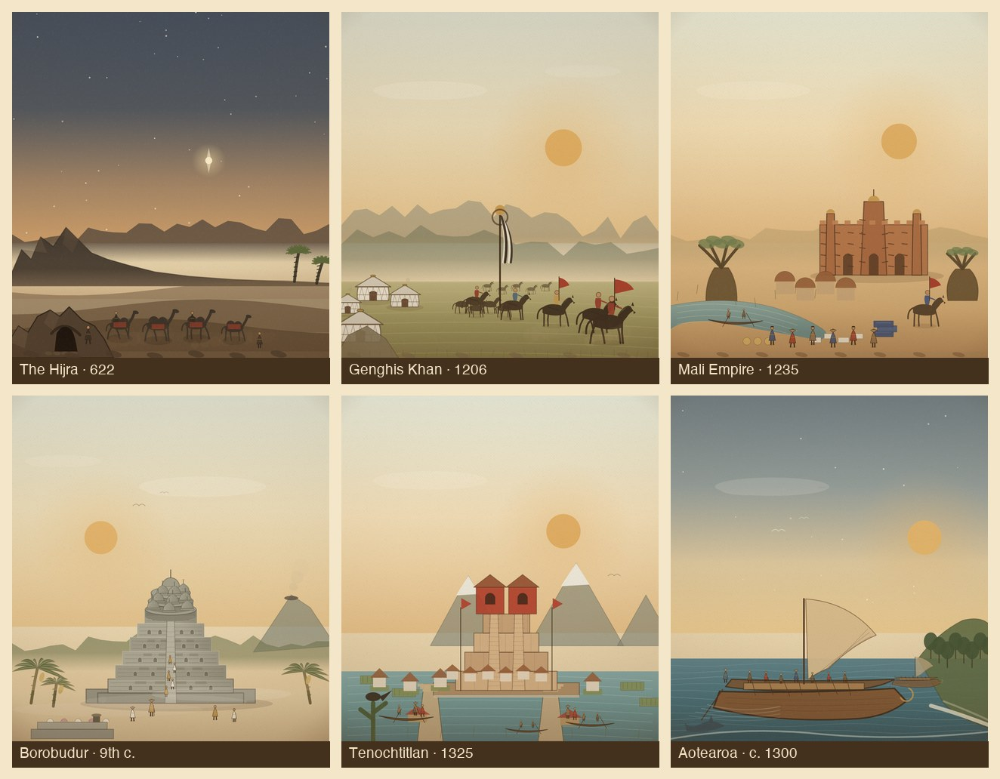

# 2B 批次复审 / Batch 2B Review

Date 2026-11-06. Scope: 6 new hero themes (6 event ids) added to the 12-theme pilot and 2A, for **24 themes / 26 event ids** total.

## 1. 本批场景

| 事件 | ID | 构图 | 主要层 |
|---|---|---|---|
| 希吉拉 | `the-hijra` | 夜行：星与指路星、山隘、洞穴、沙丘、驼队与向导 | 星空/指路星 → 山脉/霾 → 沙丘 → 岩洞 → 驼队/尘土 |
| 成吉思汗建国 | `genghis-khan` | 草原营地：九斿白纛、蒙古包群、马群与骑手、远山 | 晨空/太阳 → 山脊 → 草原 → 毡帐/旗帜 → 骑手/草石 |
| 马里帝国 | `mali-empire` | 尼日尔河与泥砖清真寺：宣礼塔、托隆木、猴面包树、独木舟、集市 | 天空/太阳 → 萨赫勒丘陵 → 地面 → 清真寺/猴面包树 → 河/集市/骑手 |
| 婆罗浮屠 | `borobudur` | 曼荼罗：六层方台、三层圆台与钟形塔、中央穹顶、火山与朝圣者 | 天空/火山 → 丛林 → 雾 → 石塔 → 朝圣者/供台 |
| 特诺奇蒂特兰建城 | `tenochtitlan-founded` | 湖上城：双神庙金字塔、堤道、独木舟、奇南帕浮田、火山 | 天空/火山 → 湖面 → 岛台/房屋 → 金字塔 → 舟/人群 |
| 毛利抵达奥特亚罗瓦 | `maori-reach-aotearoa` | 双体瓦卡：蟹爪帆、划手、海岸岬角、海豚与晨星 | 星空/晨光 → 海面 → 岬角/林 → 瓦卡 → 浪/海豚 |

## 2. 评分（1–5）

首版与复审后对比如下；复审只改构图、结构、材质与接地，不改事件/家族映射。

| 场景 | 构图/焦点 | 明暗层次 | 版画质感 | 时代地域 | 系列一致 | 手机可读 | 合计（复审后） |
|---|---:|---:|---:|---:|---:|---:|---:|
| 希吉拉 | 4 | 4 | 4 | 5 | 4 | 4 | 25 |
| 成吉思汗建国 | 4 | 3 | 4 | 5 | 4 | 4 | 24 |
| 马里帝国 | 4 | 3 | 4 | 5 | 4 | 4 | 24 |
| 婆罗浮屠 | 4 | 4 | 4 | 5 | 4 | 4 | 25 |
| 特诺奇蒂特兰 | 4 | 4 | 4 | 5 | 4 | 4 | 25 |
| 毛利抵达 | 4 | 4 | 4 | 4 | 4 | 4 | 24 |

平均 **24.5/30（4.08/5）**，与 2A 持平；构图与时代地域已达标，**版画质感仍是统一的 4**，留到 30 个 Hero 的统一 texture pass。

## 3. 复审做了什么

- **希吉拉**：山脉改为整幅连续山脊并在右侧落为平原，去掉硬垂直边；山脚加暖霾过渡；岩洞改为不规则崖体、非对称洞口、悬岩阴影与碎石；绿洲棕榈改为同向错位，消除交叉树干。
- **成吉思汗**：`ger` 重做为毡帐（鼓形墙、锥形顶、帐顶圈、哈那网格、木门），不再是“白墙尖顶小屋”；草原顶部改为渐隐，消除横贯画面的硬地平线；近山延伸为整幅山脊，去掉接缝；旗纛、骑手、马群保留。
- **马里**：补萨赫勒地面渐变，消除天空/沙地的硬分界；清真寺加接触阴影；尼日尔河末端改为自然收尖，去掉矩形色块；靛蓝布匹改为折叠布捆，盐板保留。
- **婆罗浮屠**：删掉盖在塔身与地面上的半透明三角阴影；方台加右侧受光渐变、拱形佛龛与浮雕板；圆台改为带鼓身的实体台层；钟形塔重做（基座、钟身、镂空点阵、顶环与刹），只画前半圈并按前后排序；中央穹顶落在顶层圆台上；前景供台与香炉上移，避免贴边裁切。
- **特诺奇蒂特兰**：岛台加暗色基座、码头与房屋；市场摊位与奇南帕浮田补齐；金字塔与堤道接地；湖面与火山层次保留。
- **毛利**：蟹爪帆重做，帆前缘贴桅、后缘内凹，帆桁与帆骨随形；划手改为错落站距/身高/服色；第二艘瓦卡移到近岸水面；沙滩改为沿岸浪线，去掉漂浮的浅色楔形；海豚改为跃出水面。

## 4. 做对了什么

- 六个场景的轮廓互不重复：夜行驼队、草原毡帐+旗纛、泥砖清真寺+猴面包树、曼荼罗石塔、湖上双神庙、双体帆船。
- 补齐地域缺口：西非（马里）、大洋洲（毛利）、东南亚（婆罗浮屠）、中美洲（特诺奇蒂特兰）、中亚草原（成吉思汗）、中东/伊斯兰（希吉拉）。
- 沉淀新笔刷：`ger`、`mudMosque`、`baobab`、`bellStupa` / `borobudur`、`aztecPyramid`、`waka`、`banana`；可供 Tier B/C 复用。
- 史实锚点：希吉拉洞穴与驼队、蒙古九斿白纛与毡帐、杰内式泥砖清真寺与托隆木、婆罗浮屠方台/圆台/钟塔、阿兹特克双神庙与湖田、波利尼西亚双体瓦卡与蟹爪帆。
- 统一印版基调、人物尺度、接触阴影与前景框；地图徽章仍用羽化遮罩。

## 5. 剩余差距

- **版画质感**：六张的刻线密度仍低于 v3 的 12 张强项；尤其草原、沙地、湖面的大面积平涂。统一 texture pass 处理：交叉排线、材质分层、局部高光。
- **成吉思汗**：骑手与马群的层次仍偏平，前景可再加一组更大的人物/马匹。
- **马里**：集市人群仍偏“排队”；下一轮可加坐姿、头顶货物、牵驴者。
- **毛利**：第二艘瓦卡与海岸的遮挡关系可再拉开；帆面可加编织纹。
- 以上均不阻塞 2C；30 个 Hero 完成后统一处理。

## 6. 验收

- 26/26 英雄场景可打开，0 JS 报错。
- 16 秒清理：`active=false`、`hero=null`。
- 390×844 无横向溢出；本批场景中端机 60fps。
- `validate-data`、`build-data`、`node --check js/*.js` 通过。
- 482 事件 / 56 家族映射未变；贸易 LOD、战斗上限 16、台湾省 2026、面板滚动未回归。

## 7. 下一步

1. 2B 结构复审完成（4.08/5），与 2A 同分。
2. 开 **2C**：古腾堡、达伽马、印加、法国大革命、印巴分治、万维网。
3. 30 个 Hero 完成后做统一 texture pass，再冲 Gate 1 的 4.5。
