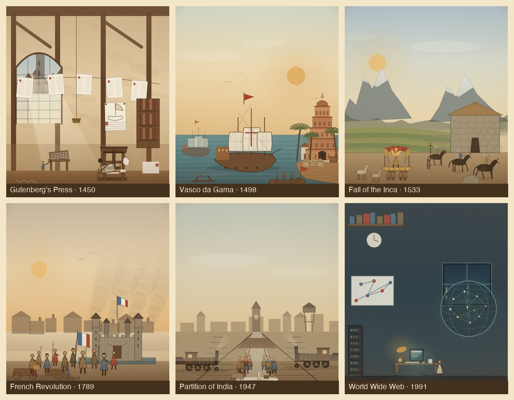

# 2C 批次复审 / Batch 2C Review

Date 2026-11-07. Scope: final 6 hero themes of Phase 2 (6 event ids) added to the pilot, 2A and 2B, for **30 themes / 32 event ids** total.

## 1. 本批场景

| 事件 | ID | 构图 | 主要层 |
|---|---|---|---|
| 古腾堡活字印刷 | `gutenbergs-press` | 美因茨印刷坊内景：木构墙、拱窗城景、螺旋压印机、排字盘、晾纸线上的印张、装订书柜 | 墙/木构 → 窗与城市 → 印张线 → 压印机/排字工 → 纸堆/散字 |
| 达伽马抵达印度 | `vasco-da-gama-reaches-india` | 卡利卡特外海：卡拉维尔帆船、印度洋暖光、红土码头、南印塔门、香料袋与登岸长艇 | 天空/太阳 → 海面 → 帆船 → 海岸/塔门/棕榈 → 长艇/香料 |
| 皮萨罗灭印加 | `fall-of-the-inca` | 卡哈马卡：安第斯雪峰、梯田、印加石厅、金轿与阿塔瓦尔帕、西班牙骑兵与修士 | 天空/雪峰 → 梯田 → 广场/石厅 → 金轿/随从 → 骑兵/羊驼 |
| 法国大革命 | `french-revolution` | 巴士底：城堡与吊桥、巴黎屋顶、烟柱、三色旗、街垒与人群 | 黎明天空/烟 → 屋顶 → 巴士底/壕沟 → 人群 → 推车/木桶/断链 |
| 印巴分治 | `partition-of-india` | 1947 火车站：两台反向蒸汽机车、站台雨棚、钟楼/水塔、界石与分界白线、迁徙人群 | 季风天空 → 城镇/钟楼 → 铁轨/站台 → 两列车 → 人群/行李/界石 |
| 万维网公开 | `the-world-wide-web` | CERN 办公室：NeXT 工作站与 CRT、服务器机柜、白板链接图、网络地球、书架与时钟 | 夜墙/书架 → 窗与夜色 → 白板/地球 → 工作站/机柜 → 研究员/线缆 |

## 2. 评分（1–5）

| 场景 | 构图/焦点 | 明暗层次 | 版画质感 | 时代地域 | 系列一致 | 手机可读 | 合计 |
|---|---:|---:|---:|---:|---:|---:|---:|
| 古腾堡 | 4 | 4 | 4 | 5 | 4 | 4 | 25 |
| 达伽马 | 4 | 4 | 4 | 5 | 4 | 4 | 25 |
| 印加 | 4 | 3 | 4 | 5 | 4 | 4 | 24 |
| 法国大革命 | 4 | 3 | 4 | 5 | 4 | 4 | 24 |
| 印巴分治 | 4 | 3 | 4 | 5 | 4 | 4 | 24 |
| 万维网 | 4 | 4 | 3 | 4 | 4 | 4 | 24 |

平均 **24.3/30（4.06/5）**。**数量上达到 30 个主题**（Gate 1 的数量条件），但质量仍低于 Gate 1 的 4.5：差距集中在版画质感与大面积平涂的明暗层次。

## 3. 复审做了什么

- **古腾堡**：压印机放大为 18 单位并移到右前景；排字盘/排字工、晾纸线、装订书柜、吊灯、木构与石膏墙纹理补齐；墙上加钉住的印刷校样（船版画 + 红首字母），与压印机形成“校样—机器”的连线；去掉悬空的蜡烛与过大的书本。
- **达伽马**：主帆加葡萄牙十字；长艇改为可载四人的深壳船，加船桨、船首旗与近舷；香料袋改为带扎口与折痕的麻袋；塔门加桶形顶与宝顶；码头/仓库/棕榈重排，避免遮挡。
- **印加**：整幅重做为不规则雪峰 + 梯田（平面 + 石砌立面）+ 石厅（多边形砌石、草顶、梯形门）+ 金轿（太阳金盘、羽冠、伞盖、四名抬夫）+ 三名骑兵 + 修士 + 羊驼；去掉重复的等腰雪山与“跑道式”梯田。
- **法国大革命**：巴士底缩小到画面内（36×26），加两座后排塔、吊桥/壕沟/城齿；人群分成数组、加儿童/鼓手/长矛/三色旗；三色旗改为整块旗布裁三色；推车/木桶/断链/卵石前景；烟柱加高。
- **印巴分治**：两台反向蒸汽机车（镜像）、站台雨棚、钟楼与水塔、界石/分界白线、两股反向人流与行李堆；去掉等距城镇块与棒棒糖水塔。
- **万维网**：工作站缩到 0.95 倍、研究员站到桌侧；白板链接图、书架文件夹、挂钟、服务器指示灯、屏幕/台灯光池；网络地球与窗景叠合。

## 4. 做对了什么

- 六个场景的轮廓与主道具互不重复：压印机、帆船+塔门、金轿+梯田、城堡+人群、双机车+站台、CRT+网络地球。
- 时代跨度补齐：1450 印刷、1498 印度洋、1533 安第斯、1789 革命、1947 去殖民、1991 数字网络；Hero 层从古代延伸到当代。
- 新笔刷沉淀：`printingPress`、`typeCase`、`gopuram`、`bastille`、`steamLoco`、`workstation`、`netGlobe`、`llama`，可供 Tier B/C 复用。
- 史实锚点：螺旋压印机与排字盘、卡拉维尔与葡萄牙十字、印加梯田/石砌/金轿、巴士底八塔/吊桥/三色旗、1947 铁路迁徙/界石、1991 NeXT 工作站与 CERN。

## 5. 剩余差距

- **版画质感**：印加梯田、法国街面、印巴站台的平涂面积大，刻线密度不足；WWW 为夜景，材质层次偏弱。统一 texture pass 处理。
- **人群**：法国与印巴的人群仍有“排队”感；需要更明确的前后遮挡与动作差异。
- **天空**：法国、印巴的上半幅偏空；可加高云/烟/鸟，或在 texture pass 中加纸面压印。
- **Gate 1**：数量已到 30 主题，但均分 4.06；不宣称通过 Gate 1，直到统一 texture pass 后复评 ≥4.5。

## 6. 验收

- 32/32 英雄场景可打开，0 JS 报错。
- 16 秒清理：`active=false`、`hero=null`。
- 390×844 无横向溢出；2C 场景实测平均 16.6ms/帧，p95 16.7ms。
- `validate-data`、`build-data`、`node --check js/*.js` 通过。
- 482 事件 / 56 家族映射未变；贸易 LOD 1 骆驼/线、战斗上限 16、台湾省 2026、面板滚动未回归。

## 7. 下一步

1. 2C 结构复审完成；Hero 数量达到 30 个主题 / 32 个事件条目。
2. 做 **30 个 Hero 的统一 texture pass**（交叉排线、材质分层、局部高光），再复评 Gate 1（目标 ≥4.5）。
3. Gate 1 通过后再讨论 60 上限；Tier B 参数化变体试点可并行准备。
