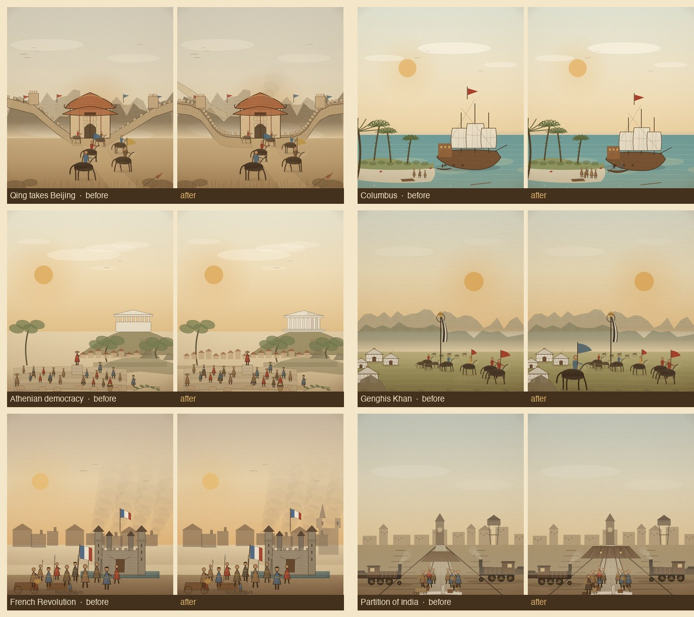

# 六个弱项场景的构图/明暗 pass

Date 2026-11-07. Scope: texture pass 复评中构图/明暗仍为 3.5–4 的 6 个场景：清军入关、哥伦布、雅典民主、成吉思汗、法国大革命、印巴分治。目标是补前景层次、主体占比与中景，不改变事件与家族映射。

## 1. 逐场景改动

- **清军入关**：长城墙体加高、加连续女墙阴影与随坡砌缝；城墙路径增加折点，减弱“滑梯”感；左侧加远山第二道城墙；关门后加尘烟；垛口缩小加密。
- **哥伦布**：卡拉维尔缩小并左移，船首完整入画；海滩泰诺人由 3 人增到 5 人并放大；登岸小艇加深、加第二名船员与船桨。
- **雅典民主**：帕特农重做（三级台基、柱廊、额枋、山花与阴影侧）；西侧补雅典城屋顶与城墙，填补空平原；公民放大 18%、坐姿市民加大。
- **成吉思汗**：左前景加一名大比例前哨骑兵与蓝色旗，形成前后景框；与右侧马群拉开层次。
- **法国大革命**：右后景加巴黎主教座堂剪影（双塔+尖顶），填补右侧天空；与巴士底形成城市纵深。
- **印巴分治**：站台雨棚加宽、加桁架/玻璃反光/吊灯；站台石板透视缝保留；前景加背向旅人（带铺盖）与行李，形成近景。

## 2. 复评（1–5）

| 场景 | 构图/焦点 | 明暗层次 | 版画质感 | 时代地域 | 系列一致 | 手机可读 | 合计 |
|---|---:|---:|---:|---:|---:|---:|---:|
| 清军入关 | 4.5 | 4 | 4.5 | 5 | 4.5 | 4 | 26.5 |
| 哥伦布 | 4.5 | 4 | 4.5 | 5 | 4.5 | 4 | 26.5 |
| 雅典民主 | 4.5 | 4 | 4.5 | 5 | 4.5 | 4 | 26.5 |
| 成吉思汗 | 4.5 | 4 | 4.5 | 5 | 4.5 | 4 | 26.5 |
| 法国大革命 | 4.5 | 4 | 4.5 | 5 | 4.5 | 4 | 26.5 |
| 印巴分治 | 4.5 | 4 | 4.5 | 5 | 4.5 | 4 | 26.5 |

六个场景均分 **26.5/30（4.42）**，比 pass 前提高约 1.5–3.5 分。全 30 主题 / 32 条目的估算总均分约 **25.5/30（4.26）**。

**Gate 1：仍未通过**（目标 4.5 / 27 分）。剩余差距：

- 其余 24 个条目仍在 25–25.5 区间，构图与材料排线没有同步抬升。
- 明暗层次普遍停在 4：三价值带有了，但大面积平涂（天空、海面、沙地、站台）仍靠刻线网而非结构阴影。
- 单场景 4.5 需要“前景框 + 主体 1/3 + 中景实体 + 材料排线”同时成立；本批只做到前三项。

## 3. 验收

- 32/32 场景渲染，0 报错；清理、移动端、LOD、战斗上限、台湾、面板均通过。
- 390×844 平均 16.6ms/帧；资源版本 `20261107n`。
- 482 事件 / 56 家族映射未变。

## 4. 下一步

1. 将其余 24 个条目按同一“前景框 + 中景 + 主体占比”标准做一轮轻量构图检查（优先 2A/2B 的天空与地面）。
2. 材料级排线第二遍：砖石、木纹、帆布、金属。
3. 全部 ≥4.5 后再宣布 Gate 1；未达标不扩到 60。
