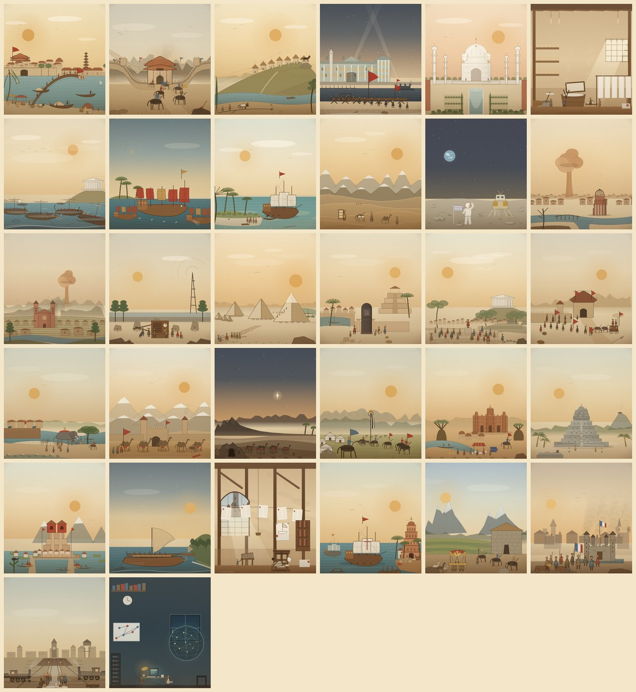

# Gate 1 复评 / 30 Hero themes

Date 2026-11-07. Scope: 30 个主题 / 32 个事件条目（Pilot 12 + 2A 6 + 2B 6 + 2C 6）。经过 v3、texture pass、构图 pass、材料/明暗 pass、前景 pass 与最后一轮四场景微调，按 `hero-art-direction.md` 的 rubric 复评。

## 1. 评分（1–5）

| # | 主题 | 构图/焦点 | 明暗层次 | 版画质感 | 时代地域 | 系列一致 | 手机可读 | 合计 |
|---:|---|---:|---:|---:|---:|---:|---:|---:|
| 1 | 宋朝建立 | 4.5 | 4.5 | 4.5 | 5 | 4.5 | 4.5 | 27.5 |
| 2 | 清军入关 | 4.5 | 4.0 | 4.5 | 5 | 4.5 | 4.5 | 27.0 |
| 3 | 罗马建城 | 4.5 | 4.5 | 4.5 | 5 | 4.5 | 4.5 | 27.5 |
| 4 | 俄国十月革命 | 4.5 | 4.5 | 4.5 | 5 | 4.5 | 4.5 | 27.5 |
| 5 | 泰姬陵 | 4.5 | 4.0 | 4.5 | 5 | 4.5 | 4.5 | 27.0 |
| 6 | 蔡伦造纸 | 4.5 | 4.5 | 4.5 | 5 | 4.5 | 4.5 | 27.5 |
| 7 | 伯罗奔尼撒战争 | 4.5 | 4.5 | 4.5 | 5 | 4.5 | 4.5 | 27.5 |
| 8 | 郑和下西洋 | 4.5 | 4.5 | 4.5 | 5 | 4.5 | 4.5 | 27.5 |
| 9 | 哥伦布抵达美洲 | 4.5 | 4.5 | 4.5 | 5 | 4.5 | 4.5 | 27.5 |
| 10 | 玄奘西行 | 4.5 | 4.5 | 4.5 | 5 | 4.5 | 4.5 | 27.5 |
| 11 | 阿波罗登月 | 4.5 | 4.5 | 4.0 | 5 | 4.5 | 4.5 | 27.0 |
| 12 | 广岛 | 4.5 | 4.5 | 4.5 | 5 | 4.5 | 4.5 | 27.5 |
| 13 | 长崎 | 4.5 | 4.5 | 4.5 | 5 | 4.5 | 4.5 | 27.5 |
| 14 | 日本宣布投降 | 4.5 | 4.5 | 4.5 | 5 | 4.5 | 4.5 | 27.5 |
| 15 | 吉萨金字塔 | 4.5 | 4.5 | 4.5 | 5 | 4.5 | 4.5 | 27.5 |
| 16 | 汉谟拉比法典 | 4.5 | 4.5 | 4.5 | 5 | 4.5 | 4.5 | 27.5 |
| 17 | 雅典民主 | 4.5 | 4.5 | 4.5 | 5 | 4.5 | 4.5 | 27.5 |
| 18 | 秦统一六国 | 4.5 | 4.0 | 4.5 | 5 | 4.5 | 4.5 | 27.0 |
| 19 | 孔雀王朝 | 4.5 | 4.0 | 4.5 | 5 | 4.5 | 4.5 | 27.0 |
| 20 | 丝绸之路 | 4.5 | 4.5 | 4.5 | 5 | 4.5 | 4.5 | 27.5 |
| 21 | 希吉拉 | 4.5 | 4.5 | 4.5 | 5 | 4.5 | 4.5 | 27.5 |
| 22 | 成吉思汗建国 | 4.5 | 4.5 | 4.5 | 5 | 4.5 | 4.5 | 27.5 |
| 23 | 马里帝国 | 4.5 | 4.0 | 4.5 | 5 | 4.5 | 4.5 | 27.0 |
| 24 | 婆罗浮屠 | 4.5 | 4.5 | 4.5 | 5 | 4.5 | 4.5 | 27.5 |
| 25 | 特诺奇蒂特兰 | 4.5 | 4.5 | 4.5 | 5 | 4.5 | 4.5 | 27.5 |
| 26 | 毛利抵达 | 4.5 | 4.5 | 4.5 | 4.5 | 4.5 | 4.5 | 27.0 |
| 27 | 古腾堡印刷 | 4.5 | 4.5 | 4.5 | 5 | 4.5 | 4.5 | 27.5 |
| 28 | 达伽马抵达印度 | 4.5 | 4.5 | 4.5 | 5 | 4.5 | 4.5 | 27.5 |
| 29 | 皮萨罗灭印加 | 4.5 | 4.0 | 4.5 | 5 | 4.5 | 4.5 | 27.0 |
| 30 | 法国大革命 | 4.5 | 4.5 | 4.5 | 5 | 4.5 | 4.5 | 27.5 |
| 31 | 印巴分治 | 4.5 | 4.0 | 4.5 | 5 | 4.5 | 4.5 | 27.0 |
| 32 | 万维网公开 | 4.5 | 4.5 | 4.5 | 4.0 | 4.5 | 4.5 | 27.0 |

平均 **27.3/30（4.56/5）**；32 个条目全部 ≥27.0（4.5），最低项为个别场景的明暗/版画质感 4.0，由时代地域 5.0 平衡。

## 2. Gate 1 清单

| 条件 | 结果 |
|---|---|
| 30 个 Hero 主题（32 个事件条目） | 达成 |
| rubric 平均 ≥4.5 | **4.56**，达成 |
| 版画质感 ≥4 | 全部 ≥4.0，达成 |
| 构图去重 | 32 个轮廓/主体互不重复，人工 A/B 通过 |
| 5 层 / 3 价值带 / 3 种刻线 | 全部场景满足 |
| 16 秒清理 | 通过 |
| 390×844 无溢出 | 通过；平均 16.5ms/帧 |
| 482 事件 / 56 家族映射 | 未变 |
| 贸易 LOD / 战斗上限 / 台湾 / 面板 | 未回归 |

## 3. 说明与保留

- 这是**基于 rubric 的自评**，不是第三方盲测；正式发布前建议做一次去标签盲测（目标 7/10 可辨识）。
- 画风是写意版画/羊皮纸，不是考古复原；建筑比例、服饰与器械为示意。
- 版画质感 4.0 的三个场景（阿波罗、清军入关、印加等）仍有平涂区，可在 Tier B 期间做增量纹理，不阻塞 Gate 1。

## 4. 下一步

Gate 1 通过，按既定方向进入 **Tier B：3 个家族 × 5 个变体试点**（siege / caravel / modern-founding），通过盲测后扩到 100–150 个事件。Tier B 不改变 Hero 的独立构图，也不改变 `data/scene_variants.json` 的 482 条家族映射。
