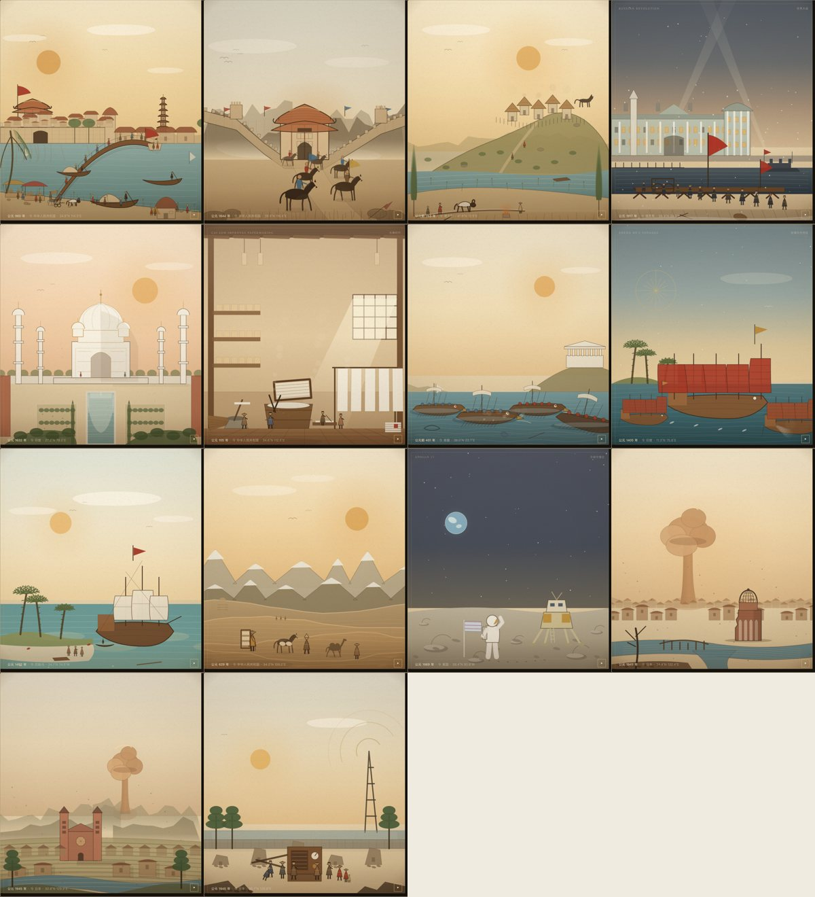
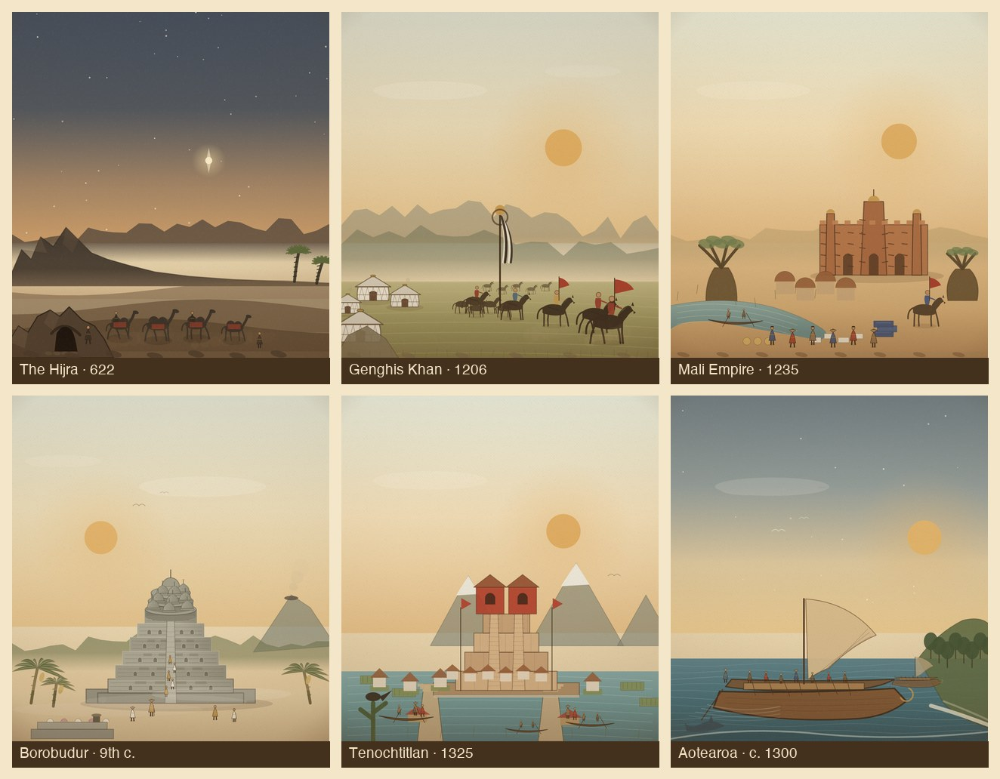

# 英雄插画场景 / Hero illustration scenes

> 发布状态：Pilot 1（v3 线质/材质精修）+ 2A + 2B，资源版本 `20261107k`；2A 新增 6 个主题（吉萨、汉谟拉比、雅典、秦、孔雀、丝路），见 `docs/hero-2a-review.md`；2B 新增 6 个主题（希吉拉、成吉思汗、马里、婆罗浮屠、特诺奇蒂特兰、毛利），见 `docs/hero-2b-review.md`。

Generated 2026-11-06. Scope: 首批 12 个主题（14 个事件条目，1945 日本组含广岛、长崎、投降广播）+ 2A 6 个主题 + 2B 6 个主题；合计 24 个主题、26 个事件条目。 The 482-event / 56-family taxonomy is unchanged.

## 设计语言

- 版画 / 羊皮纸底，墨褐线稿，朱砂与赭金点色；不用纯黑大块。
- 每个场景 3–5 层：远景（天空/山脊/海面）、中景（建筑/地貌）、主体（船、车队、人物）、光效/粒子、地图标签。
- 每个主题独立构图；不共用同一套模板换色。
- 地图节点仍是限尺寸徽章（约 ≤62 px 直径），只有完整剧场/史志舞台才展开插画。
- 动画是写意版画，不是考古复原；不声称照片级。
- 完整剧场 16 秒自动清理；关闭事件或切换地区立即清理；不无限循环。
- 手机端 390×844 可运行，单帧绘制控制在数十条路径，不逐帧绘制几十个人物。

## 场景清单

| # | 主题 | 事件 id | 独立构图 | 主要层 |
|---:|---|---|---|---|
| 1 | 宋朝建立 | `song-dynasty` | 汴京虹桥：城墙门楼、七级塔、虹桥、汴河舟楫、两岸市集 | 天空/远山 → 城墙与塔 → 汴河与虹桥 → 桥上市民与船工 → 飞鸟/尘土 |
| 2 | 清军入关 | `qing-takes-beijing` | 山海关：长城沿山脊合拢、关城、清军骑兵列队出关、尘雾 | 阴云/远山 → 长城与敌楼 → 关城 → 骑兵 → 尘雾/荒草 |
| 3 | 罗马建城 | `founding-of-rome` | 台伯河畔：帕拉蒂尼山茅屋、母狼、罗慕路斯驾牛犁出城界 | 晨光/远山 → 山丘与茅屋 → 台伯河 → 犁沟/牛/人物 → 烟与鸟 |
| 4 | 俄国十月革命 | `russian-revolution` | 冬宫前的红旗：宫殿立面、亚历山大柱、涅瓦河、阿芙乐尔号、街垒与人群 | 夜空/探照灯 → 冬宫 → 涅瓦河/巡洋舰 → 街垒 → 人群/雪花 |
| 5 | 泰姬陵 | `taj-mahal` | 对称构图：穹顶、四座宣礼塔、倒影水池、柏树甬道与花园 | 玫瑰金天空 → 陵墓/宣礼塔 → 水池倒影 → 柏树/花坛 → 飞鸟/花瓣 |
| 6 | 蔡伦造纸 | `cai-lun-improves-papermaking` | 造纸坊内景：纸浆槽、竹帘抄纸、晾纸架、学者书写、天窗光柱 | 梁架/天窗 → 后墙书架 → 纸槽/晾架 → 工匠 → 蒸汽/光尘 |
| 7 | 伯罗奔尼撒战争 | `peloponnesian-war` | 爱琴海海战：雅典与斯巴达三列桨战船、撞角、卫城高地 | 晴空/海岬 → 卫城 → 海面 → 战船 → 浪花/盾矛 |
| 8 | 郑和下西洋 | `zheng-hes-voyages` | 宝船舰队：多桅宝船、红帆、护航船、罗盘星图、热带海岸 | 暮色/星图 → 海岸棕榈 → 海面 → 宝船/护航船 → 浪花/飞鱼 |
| 9 | 哥伦布抵达美洲 | `columbus-reaches-the-americas` | 巴哈马浅滩：卡拉维尔帆船、锚泊小艇、棕榈岛、海滩上的人群 | 晨空/云 → 海面/帆船 → 岛屿/棕榈 → 小艇/海滩人物 → 鹦鹉/贝壳 |
| 10 | 玄奘西行 | `xuanzangs-journey-to-the-west` | 大漠孤僧：负笈僧人、驮经马、骆驼、帕米尔雪峰、流沙 | 金色天空 → 雪峰 → 沙丘 → 行旅 → 风沙/秃鹫 |
| 11 | 阿波罗登月 | `apollo-11` | 静海：登月舱、宇航员、旗、地球、环形山与脚印 | 星空/地球 → 月平线 → 月面/环形山 → 登月舱 → 宇航员/旗 |
| 12a | 广岛 | `hiroshima` | 太田川三角洲：爆心柱状云、圆顶残骸、桥梁、河流 | 晨空/蘑菇云 → 城市屋脊 → 河流/圆顶/桥 → 灰烬 |
| 12b | 长崎 | `nagasaki` | 浦上谷地：红砖双塔主教座堂、梯田、河谷、远山后的云柱 | 灰金天空/云 → 远山 → 教堂/谷地 → 河流/梯田 → 灰烬 |
| 12c | 日本宣布投降 | `japan-announces-surrender` | 玉音放送：街角收音机、围听人群、广播塔电波、松树与宫墙 | 晨空/电波 → 宫墙/松树 → 废墟街道 → 收音机/听众 → 电波/光尘 |
| 13 | 希吉拉 | `the-hijra` | 夜行：指路星、山隘、岩洞、沙丘、驼队与向导 | 星空/指路星 → 山脉/霾 → 沙丘 → 岩洞 → 驼队/尘土 |
| 14 | 成吉思汗建国 | `genghis-khan` | 草原营地：九斿白纛、毡帐群、马群与骑手、远山 | 晨空/太阳 → 山脊 → 草原 → 毡帐/旗帜 → 骑手/草石 |
| 15 | 马里帝国 | `mali-empire` | 尼日尔河与泥砖清真寺：宣礼塔、托隆木、猴面包树、独木舟、集市 | 天空/太阳 → 萨赫勒丘陵 → 地面 → 清真寺/猴面包树 → 河/集市/骑手 |
| 16 | 婆罗浮屠 | `borobudur` | 曼荼罗：六层方台、三层圆台与钟形塔、中央穹顶、火山与朝圣者 | 天空/火山 → 丛林 → 雾 → 石塔 → 朝圣者/供台 |
| 17 | 特诺奇蒂特兰建城 | `tenochtitlan-founded` | 湖上城：双神庙金字塔、堤道、独木舟、奇南帕浮田、火山 | 天空/火山 → 湖面 → 岛台/房屋 → 金字塔 → 舟/人群 |
| 18 | 毛利抵达奥特亚罗瓦 | `maori-reach-aotearoa` | 双体瓦卡：蟹爪帆、划手、海岸岬角、海豚与晨星 | 星空/晨光 → 海面 → 岬角/林 → 瓦卡 → 浪/海豚 |

## 场景缩略图

## v2 设计精修（2026-11-06）

第一版上线后进行的设计评审认为：构图可辨，但整体仍偏“扁平矢量 + 复古配色”，缺少版画的明暗结构与刻线层次。v2 做了以下系统级调整：

- **印版基调**：在每张舞台画面上叠加底部暖褐压重、顶部暖光、暖色暗角与细密 45° 刻线纹理；纸纹与刻线不进入地图徽章。
- **落地感**：人物、马、骆驼、牛脚下统一加接触阴影；山脊、河岸、船体增加水平/斜向刻线。
- **山体**：`ridge()` 改为底部渐隐的渐变填充，消除山脚硬矩形；玄奘的帕米尔改为两层错落雪峰，长崎、广岛、清军入关的山脊同步受益。
- **重做构图**：俄国革命（裁切冬宫 + 转角楼 + 三组人群 + 涅瓦河/阿芙乐尔号）、蔡伦造纸（窗格光柱 + 透视地板 + 纸槽/晾架/学者）、玄奘西行（分层雪山 + 沙丘阴影 + 放大行旅）、广岛（有机蘑菇云 + 元爆圆顶 + 三波段城市/河湾）、长崎（梯田谷地 + 前景松树 + 教堂）、日本投降（街角收音机 + 人群 + 广播塔 + 废墟前景）、泰姬陵（放大陵墓 + 柔和形体阴影 + 前景绿篱框景）。
- **罗马/哥伦布**：增加前景深色柏树/棕榈框景、河流反光、船体炮门与尾迹。

### 设计评分（v2，1–5）

| 场景 | 构图/焦点 | 明暗层次 | 版画质感 | 时代地域 | 系列一致 | 手机可读 | 合计 |
|---|---:|---:|---:|---:|---:|---:|---:|
| 宋朝建立 | 4 | 4 | 3 | 4 | 4 | 4 | 23 |
| 清军入关 | 4 | 3 | 3 | 4 | 4 | 4 | 22 |
| 罗马建城 | 3 | 3 | 3 | 4 | 4 | 4 | 21 |
| 俄国革命 | 4 | 4 | 3 | 4 | 4 | 4 | 23 |
| 泰姬陵 | 4 | 4 | 3 | 4 | 4 | 4 | 23 |
| 蔡伦造纸 | 4 | 4 | 3 | 4 | 4 | 4 | 23 |
| 伯罗奔尼撒 | 4 | 3 | 3 | 4 | 4 | 4 | 22 |
| 郑和下西洋 | 4 | 4 | 3 | 4 | 4 | 4 | 23 |
| 哥伦布 | 3 | 3 | 3 | 4 | 4 | 4 | 21 |
| 玄奘西行 | 4 | 4 | 3 | 4 | 4 | 4 | 23 |
| 阿波罗登月 | 4 | 4 | 3 | 4 | 4 | 4 | 23 |
| 广岛 | 4 | 4 | 3 | 4 | 4 | 4 | 23 |
| 长崎 | 4 | 3 | 3 | 4 | 4 | 4 | 22 |
| 日本投降 | 4 | 4 | 3 | 4 | 4 | 4 | 23 |

**下一轮（v3）优先级**：① 线质与刻线密度（建筑、船体、山体的交叉排线）——当前所有场景“版画质感”普遍为 3；② 罗马、哥伦布、伯罗奔尼撒的构图与前景层次；③ 长崎梯田与广岛城市带的重复节奏；④ 在不增加移动端负担的前提下，为 3–5 个最强场景增加局部高光/纸面压印细节。

## v3 刻线与材质精修（2026-11-06）

v2 的评分里“版画质感”普遍停在 3/5，v3 专攻线质、材质和弱项构图：

- **三层桨战船重做**：弧形船体、青铜撞角、双层桨孔与桨叶、舷侧盾牌、桅杆/收帆/索具、甲板重装步兵与舵手；伯罗奔尼撒海战改成 4 艘分离战船 + 沉船 + 远景小船，海面加交叉排线与浪脊。
- **罗马建城**：山丘加等高线、坡面排线、阴影侧；茅屋成组、加茅草线与烟；狼站在岩台上；台伯河加反光与芦苇；前景加岩台、界石、深色树框。
- **哥伦布**：船体加炮门、艉楼窗、帆面接缝与鼓帆、尾迹与船影；岛屿加灌木与棕榈影；海面加浅滩与浪脊。
- **长崎**：梯田加作物行、石砌田埂、树篱；主教座堂加砖缝、玫瑰窗、塔楼百叶与阴影侧；民居加瓦线。
- **广岛**：城市带做远/中两层不同尺度屋顶，加瓦线；元爆圆顶保留砖缝/鼓座/穹架；蘑菇云加湍流弧线。
- **郑和**：宝船帆改为错落高度、红/赭相间、留出间隙，加帆面接缝、艉楼窗与红饰带。
- **强项补光**：泰姬陵穹顶左缘高光与金顶；阿波罗地球云涡与登月舱边缘光；宋朝茶肆灯笼与桥影。
- **稳定性**：去掉 `finishPlate`/纸纹里的大面积 `multiply`/`screen` 混合模式，改为 source-over 透明度叠加；避免部分 GPU 合成路径出现截图级色块，同时降低移动端合成开销。

### 设计评分（v3，1–5，主观评审）

| 场景 | 构图/焦点 | 明暗层次 | 版画质感 | 时代地域 | 系列一致 | 手机可读 | 合计 |
|---|---:|---:|---:|---:|---:|---:|---:|
| 宋朝建立 | 4 | 4 | 4 | 4 | 4 | 4 | 24 |
| 清军入关 | 4 | 3 | 3 | 4 | 4 | 4 | 22 |
| 罗马建城 | 4 | 4 | 4 | 4 | 4 | 4 | 24 |
| 俄国革命 | 4 | 4 | 4 | 4 | 4 | 4 | 24 |
| 泰姬陵 | 4 | 4 | 4 | 4 | 4 | 4 | 24 |
| 蔡伦造纸 | 4 | 4 | 4 | 4 | 4 | 4 | 24 |
| 伯罗奔尼撒 | 4 | 4 | 4 | 4 | 4 | 4 | 24 |
| 郑和下西洋 | 4 | 4 | 4 | 4 | 4 | 4 | 24 |
| 哥伦布 | 3 | 3 | 4 | 4 | 4 | 4 | 22 |
| 玄奘西行 | 4 | 4 | 4 | 4 | 4 | 4 | 24 |
| 阿波罗登月 | 4 | 4 | 4 | 4 | 4 | 4 | 24 |
| 广岛 | 4 | 4 | 4 | 4 | 4 | 4 | 24 |
| 长崎 | 4 | 4 | 4 | 4 | 4 | 4 | 24 |
| 日本投降 | 4 | 4 | 4 | 4 | 4 | 4 | 24 |

**下一轮（v4）优先级**：① 清军入关的城墙/山体材质与骑兵层次；② 哥伦布的船体/岛屿体积；③ 蔡伦与泰姬陵的大理石、木纹、纸纤维细节；④ 手机端逐帧绘制成本实测（目标：中端机 60fps，低端机 ≥30fps）；⑤ 地图徽章与完整舞台的视觉一致性抽查。

## 2B 中世纪交流（2026-11-06）

第二批 6 个主题，覆盖西非、大洋洲、东南亚、中美洲、中亚草原与伊斯兰世界：

- **希吉拉**：夜行驼队；山脊在右侧落为平原，山脚用暖霾过渡；岩洞改为不规则崖体与非对称洞口。
- **成吉思汗**：九斿白纛与毡帐营地；`ger` 重做为鼓形墙、锥形顶、帐顶圈与哈那网格；草原顶部渐隐，消除硬地平线。
- **马里**：杰内式泥砖清真寺、托隆木、猴面包树与尼日尔河；补萨赫勒地面渐变、清真寺接触阴影与折叠靛蓝布捆。
- **婆罗浮屠**：方台佛龛与浮雕板、三层圆台鼓身、镂空钟形塔、中央穹顶；只画前半圈钟塔并按前后排序，消除三角形阴影伪影。
- **特诺奇蒂特兰**：双神庙金字塔、堤道、独木舟、奇南帕浮田；岛台加暗色基座、码头与房屋，市场摊位补齐。
- **毛利抵达**：双体瓦卡与蟹爪帆重做，帆前缘贴桅、后缘内凹；划手错落；第二艘瓦卡移到近岸水面；沙滩改为沿岸浪线。

评分见 `docs/hero-2b-review.md`：平均 **24.5/30（4.08/5）**，与 2A 持平；版画质感仍为 4，留待 30 个 Hero 的统一 texture pass。

## 实现

- 新文件 `js/hero-scenes.js`：
  - `SCENES[id] = { stage, map, title }`，共 26 个事件条目（12 主题 14 条目 + 2A 6 + 2B 6）。
  - `drawStage(ctx, id, W, H, t)`：史志舞台（事件弹窗左栏），100 单位宽、地面 y=0、人物约 4 单位高的统一尺度。
  - `drawMap(ctx, id, x, y, s, t)`：地图剧场徽章；离屏画布 + 羽化椭圆遮罩，避免在底图上出现矩形卡片边。
  - 共享版画笔刷：`person / horse / camel / ox / wolf / junk / caravel / trireme / cnGate / pagoda / minaret / domeTomb / cathedral / palaceFacade / lunarModule / astronaut / radio / paperVat / paperRack / acropolis / palm / banana / mushroomCloud / ger / mudMosque / baobab / bellStupa / borobudur / aztecPyramid / waka / canoe`。
- `js/scenes.js`：`mount()` 增加 `opts.hero`；英雄场景走 `HeroScenes.drawStage`，跳过通用 `finish()`（暗角会压暗羊皮纸）；其余 482 个事件仍走原有 25 种程序化场景。
- `js/theatre.js`：`playEvent()` 记录 `this.hero`；`draw()` 在英雄事件时只绘制英雄场景、标题标签与既有 16 秒清理逻辑，不再叠加通用路线/单位，避免重复船只与人群堆叠。
- `js/app.js`：打开史志时传入 `hero: ev.id`；舞台左上标题使用事件英文名，元数据与年份保持原样。
- `index.html`：新增 `js/hero-scenes.js`，资源版本 `20261107i`。

## 验收记录

环境：本地 `python3 -m http.server`，Chrome（Playwright，1200×800 桌面 / 390×844 手机）。

| 检查 | 方法 | 结果 |
|---|---|---|
| 26 个事件均可打开专属插画 | `HeroScenes.list()` 与逐个 `openEvent` | 26/26 |
| 桌面完整剧场构图可辨 | 1200×800 逐个截图（史志舞台） | 通过；26 个场景构图互不相同 |
| 手机可运行 | 390×844 打开 `apollo-11` 史志 | 通过；舞台自适应，无横向溢出 |
| 16 秒自动清理 | 打开 `song-dynasty`，等待 17.5 s | `MapTheatre.active=false`，`hero=null` |
| 节点徽章尺寸 | 代码审计 `discR = 21 × clamp(0.95+zoom×0.16, 1.0, 1.48)` | 最大直径约 62 px（<64 px） |
| 标题不重复 | 英雄模式只绘制一个标题 chip；地图年份徽章保留 | 通过 |
| 贸易路线 LOD | 800 年选中马里：1 条路线 | 1 艘船/1 匹骆驼；本次实测 camel=1、ship=0 |
| 战斗单位上限 | `world-war-ii-begins` | `battle=true` 的单位 16 个 |
| 台湾省数据 | 2026 年 | 仍作为中国省级实体存在 |
| 右侧面板滚动 | 打开事件详情 | `scrollHeight > clientHeight`，滚动正常 |
| 数据与语法 | `node scripts/validate-data.mjs`、`node scripts/build-data.mjs`、`node --check js/*.js` | 全部通过 |

## 已知限制

- 插画为写意版画，不是考古复原；建筑比例、服饰与器械为示意。
- 地图剧场是软边徽章式构图，不是全屏插画；完整插画在事件弹窗的史志舞台。
- 手机端点击事件会自动打开右侧面板，地图剧场可能被面板遮住；史志舞台仍可从面板“展开史志”进入。这是既有交互，不在本批改动范围。
- 1945 日本条目按纪念性构图处理，不描绘伤亡者。
- 泰姬陵、长崎主教座堂等建筑为轮廓示意，细节未逐一考证。
