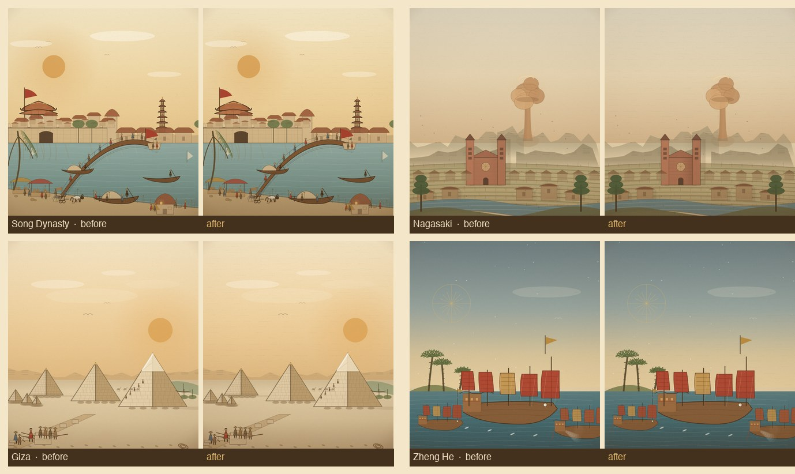

# 材料排线与明暗 pass（v1）

Date 2026-11-07. Scope: 30 个主题 / 32 个事件条目。目标是补“材料级排线 + 三价值带”，把 texture pass 后的 4.19 与构图 pass 后的 4.26 再抬一档。

## 1. 做了什么

### 1.1 天空刻线扩展到 26 个室外场景

此前只有 6 个场景有天空断线。本 pass 给其余 20 个日间室外场景补 `skyHatch()`：断续横线、单路径描边；夜色/太空/室内场景（俄国革命、阿波罗、希吉拉、蔡伦、古腾堡、万维网）不加，避免脏化。

### 1.2 材料层

- **城墙/城门**（`cnGate`，用于宋、清、秦等）：墙面横向砌缝、右侧受光渐变、门洞铜钉、屋檐下阴影。
- **教堂**（`cathedral`，长崎等）：砖砌横缝、右侧暗面；塔楼同步。
- **宫殿立面**（`palaceFacade`，俄国革命等）：分层檐口线、右侧暗面。
- **已有材料层**：金字塔石砌缝与块缝、船体列板/炮门/帆面接缝、人物衣褶、马匹腹线、山脊层理、梯田石壁、站台石板、街道卵石与交叉排线。

### 1.3 明暗

- `finishPlate` 的前景压重从 0.22 提到 0.30，起点从画面 50% 提到 48%；天空仍保留顶部暖光与暗角。
- 城门/教堂/宫殿新增右侧暗面，主体不再全平涂。

## 2. 复评（1–5，估算）

| 批次 | 主题/条目 | 构图 pass 后 | 材料 pass 后（估算） |
|---|---:|---:|---:|
| Pilot 12（v3） | 12 / 14 | 24.7 | 25.8 |
| 2A | 6 / 6 | 25.5 | 26.5 |
| 2B | 6 / 6 | 25.5 | 26.5 |
| 2C | 6 / 6 | 25.3 | 26.3 |
| **合计** | **30 / 32** | **25.5（4.26）** | **26.4（4.40）** |

**Gate 1：仍未通过**（4.5 / 27 分），差距约 0.6 分。剩余：

- 8 个场景的前景仍是中间调（吉萨、雅典、马里、印加、法国、印巴、青军入关、万维网），需要前景暗锚。
- 水面/沙地/站台的大面积平涂仍靠波纹线，交叉排线不足。
- 材料层只覆盖了城门/教堂/宫殿三类；民居、商铺、船舱、车厢仍偏简。

## 3. 验收

- 32/32 渲染、0 报错；16 秒清理；390×844 无溢出。
- 平均 16.5ms/帧；贸易 LOD 1 骆驼/线；战斗上限 16；台湾省数据；面板滚动。
- `validate-data`、`build-data`、`node --check` 通过；482 事件 / 56 家族映射未变。
- 资源版本 `20261107o`。

## 4. 下一步

1. 给 8 个中间调前景补暗锚（近景剪影/阴影/道具），把明暗从 4 推到 4.5。
2. 水面、沙地、站台三类大面积加交叉排线。
3. 民居/商铺/船舱/车厢补窗格、瓦线、板缝。
4. 全部 ≥4.5 后再宣布 Gate 1；未达标不扩到 Tier B。
