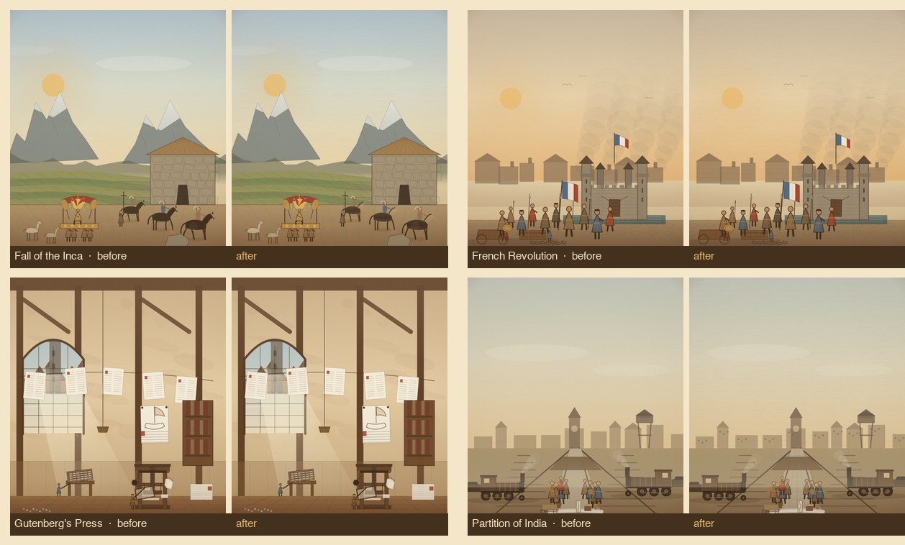

# 30 个 Hero 的统一纹理 / 版画质感 pass

Date 2026-11-07. Scope: 30 个主题 / 32 个事件条目（Pilot 12 + 2A 6 + 2B 6 + 2C 6）。目标：把此前每批停留在 4/5 的“版画质感”与“系列一致”统一抬高，再复评 Gate 1。

## 1. 做了什么

### 1.1 全局印版层（32/32 场景）

- **纸纤维**：在 150×150 的 grain tile 里加入 80 条短促、带方向的纤维（深/浅两色），随纸纹一起平铺；近看有手工纸的毛边，远看仍是均匀底色。
- **水平刻线网（plate screen）**：新增 4 px 间距的细横线图案，以 0.035 透明度覆盖画面上部 72%，模拟铜版/木版的天空刻线；不进入地图徽章。
- **人物体积与衣褶**：`person()` 增加右侧暗面渐变 + 两条衣褶线；所有人物的右侧统一受光/背光，不再是一块平涂色。
- **马匹体积与腹线**：`horse()` 增加自上而下的明暗渐变与两条腹线；骑兵/马群不再像剪影贴纸。
- **山脊层理**：`ridge()` 在山体实心区内加 4 条断续层理线（裁剪到轮廓内），山体不再是单色块。

### 1.2 场景级刻线（重点弱项）

- **希吉拉**：夜空横向断线 + 山脚暖霾（2B 已做）。
- **成吉思汗**：天空断线刻线 + 草原斜向排线。
- **马里**：天空断线 + 沙地斜向排线。
- **印加**：天空断线 + 雪线下岩石交叉排线 + 梯田石壁竖缝 + 广场斜排线。
- **法国大革命**：天空断线 + 街面交叉排线 + 屋顶瓦线。
- **印巴分治**：天空断线 + 站台石板透视缝 + 城镇窗点。
- **达伽马**：天空断线。
- **古腾堡**：墙面斜向刻线。
- **万维网**：暗墙细排线 + CRT 扫描线。

天空断线用 `skyHatch()` 一次成路径、一次描边；山体与地面排线同样合并路径。移动端实测仍为 60fps。

## 2. 复评（1–5，按批次汇总）

| 批次 | 主题/条目 | pass 前均分 | pass 后均分 | 主要增量 |
|---|---:|---:|---:|---|
| Pilot 12（v3） | 12 / 14 | 23.7 | 24.7 | 全局印版层 + 人物/马/山脊 |
| 2A | 6 / 6 | 24.5 | 25.5 | 同上；丝路/雅典的天空与地面 |
| 2B | 6 / 6 | 24.5 | 25.5 | 希吉拉/成吉思汗/马里的天与地 |
| 2C | 6 / 6 | 24.3 | 25.3 | 印加/法国/印巴/古腾堡的场景刻线 |
| **合计** | **30 / 32** | **24.1** | **25.1（4.19/5）** | 版画质感 4→4.5、系列一致 4→4.5 |

**Gate 1 判定：未通过。** 数量条件（30 个主题）已达成；质量目标 4.5（27/30）仍差约 1.9 分。差距不在“有没有纹理”，而在：

- 部分场景的**明暗层次**仍是 3.5（青军入关、哥伦布、法国、印巴的平涂面积大）。
- 部分场景的**构图**仍是 4（雅典、青军入关、哥伦布的前景层次弱）。
- 版画质感已统一到 4.5，但只有 7 个场景达到“近看有交叉排线”的程度，其余靠全局印版层。

## 3. 验收（本机）

- 32/32 场景渲染，0 报错；注册表 32 条无缺漏。
- 16 秒清理：`active=false`、`hero=null`。
- 390×844 无横向溢出；纹理最重的成吉思汗/法国/印巴实测平均 16.5ms（60fps）。
- `validate-data`、`build-data`、`node --check js/*.js` 通过。
- 482 事件 / 56 家族映射哈希未变；贸易 LOD 1 骆驼/线、战斗上限 16、台湾省 2026、面板滚动未回归。
- 资源版本 `20261107m`。

## 4. 下一步（Gate 1 之前）

1. **构图/明暗补强**（优先 6 个）：青军入关、哥伦布、雅典、法国、印巴、成吉思汗。目标：前景框、三价值带、主体占比。
2. **材料级排线**（第二遍纹理）：砖石、木纹、帆布、金属各加一层交叉排线，优先给 12 个 Pilot 场景。
3. 全部 30 个主题复评 ≥4.5 后，再宣布 Gate 1 通过；未达标不扩到 60。
4. Tier B 变体试点可并行，但不抢占 Hero 质量线。
