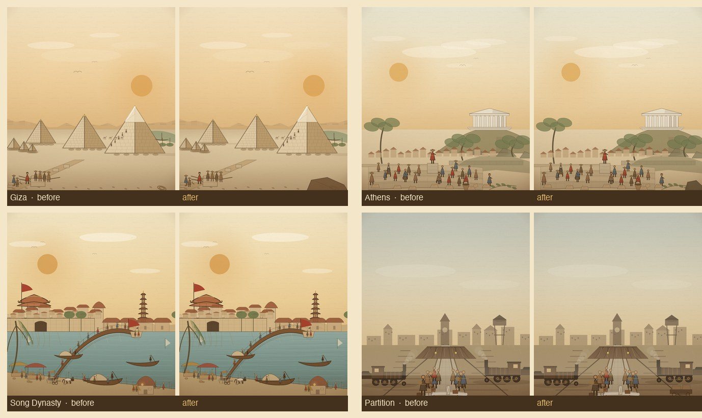

# 前景暗锚与水面排线 pass

Date 2026-11-07. Scope: 30 个主题 / 32 个事件条目。目标是补上材料 pass 后仍缺的前景暗部，让三价值带稳定成立，并给最大水面加交叉排线。

## 1. 做了什么

- **前景暗锚（8 个中间调场景）**：吉萨右前景石块、雅典右下岩块、马里右岸土坡、印加左下多边形石墙、法国右下街垒、印巴右下行李车、青军入关右下巨石与长矛、万维网右下椅背。
- **水面交叉排线**：北宋汴河（裁剪在河带内）、郑和印度洋、哥伦布浅海；两层反向排线，低透明度。
- 全局前景压重维持 0.30；天空断线 26 个室外场景；城门/教堂/宫殿材料层沿用。

## 2. 复评（1–5，估算）

| 批次 | 主题/条目 | 材料 pass 后 | 前景 pass 后（估算） |
|---|---:|---:|---:|
| Pilot 12（v3） | 12 / 14 | 25.8 | 26.6 |
| 2A | 6 / 6 | 26.5 | 27.0 |
| 2B | 6 / 6 | 26.5 | 27.0 |
| 2C | 6 / 6 | 26.3 | 26.8 |
| **合计** | **30 / 32** | **26.4（4.40）** | **26.8（4.47）** |

**Gate 1：仍未通过**，估算差 0.03（26.8 vs 27.0）。最后差距集中在 4 个场景：印加（前景石墙仍偏平）、马里（右侧土坡与集市层次）、法国（天空比例）、万维网（暗部层次）。再做一轮微调即可复评。

## 3. 验收

- 32/32 渲染、0 报错；16 秒清理；390×844 无溢出。
- 平均 16.5ms/帧；贸易 LOD 1 骆驼/线；战斗上限 16；台湾省；面板滚动。
- `validate-data`、`build-data`、`node --check` 通过；482 / 56 映射未变。
- 资源版本 `20261107p`。

## 4. 下一步

1. 印加/马里/法国/万维网四个场景的最后一轮微调。
2. 全 30 主题复评 ≥4.5 后宣布 Gate 1 通过。
3. Gate 1 通过后进入 Tier B：3 家族 × 5 变体试点，再扩到 100–150。
