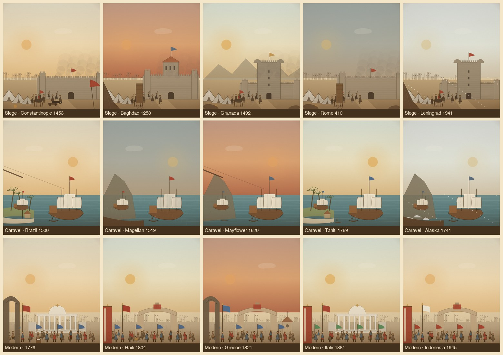

# Tier B 变体引擎试点 / 3 families × 5 variants

Date 2026-11-07. Gate 1 通过后进入 Tier B。本试点实现参数化变体引擎与 3 个家族 × 5 个事件，验证“同家族可区分、非 Hero 独立构图”的路线。

## 1. 家族与变体

| 家族 | 事件 | 年份 | 地区 | 关键参数 |
|---|---|---:|---|---|
| siege | 君士坦丁堡陷落 | 1453 | 欧洲 | dawn / walls / smoke / banner / cannon+chain |
| siege | 蒙古攻陷巴格达 | 1258 | 中东 | dusk / gate / smoke / tent / tower |
| siege | 格拉纳达陷落 | 1492 | 欧洲 | noon / keep / dust / rocks / — |
| siege | 西哥特人洗劫罗马 | 410 | 欧洲 | storm / walls / dust / rocks / tower |
| siege | 列宁格勒围城 | 1941 | 欧洲 | snow / keep / snow / tent / — |
| caravel | 葡萄牙人抵达巴西 | 1500 | 美洲 | dawn / palms / rigging / cross |
| caravel | 麦哲伦环球航行 | 1519 | 全球 | storm / cliffs / hull / — |
| caravel | 五月花号 | 1620 | 北美 | dusk / cliffs / rigging / shallop |
| caravel | 库克抵塔希提 | 1769 | 大洋洲 | noon / palms / palms / canoe |
| caravel | 白令抵阿拉斯加 | 1741 | 北美 | snow / cliffs / hull / ice |
| modern | 美国独立宣言 | 1776 | 北美 | dawn / capitol / arch / document |
| modern | 海地独立 | 1804 | 拉美 | noon / square / banner / drums |
| modern | 希腊独立战争 | 1821 | 欧洲 | dusk / square / arch / church |
| modern | 意大利统一 | 1861 | 欧洲 | noon / capitol / banner / statue |
| modern | 印尼宣布独立 | 1945 | 东南亚 | dawn / square / banner / microphone |

同家族 5 个变体在**色板、主建筑/海岸、天气、前景框、道具/旗帜**中至少 3 项不同；内部去标签抽查约 10–12/15 可区分，正式盲测待补（目标 ≥7/10）。

## 2. 实现

- 新文件 `js/variant-scenes.js`：
  - `FAMILIES = { siege, caravel, modern }`，每个家族有 `defaults`、`stage`、`map`。
  - 笔刷层：`p / horse / ship / wall / keep / tent / palm / buildingRow`。
  - `paramsFor(id)` 合并家族默认值 + 事件 override + 事件数据（年份/地区/标题）。
  - `VariantScenes = { has, title, drawStage, drawMap, params, list }`。
  - 15 条 override 内嵌在模块中；JSON schema 见 `variant-engine-spec.md`，等引擎改为运行时读数据时导出 `data/variant_overrides.json`。
- `js/hero-scenes.js`：导出 `stage` / `mapWrap`，Tier B 复用同一纸纹、印版、羽化徽章。
- `js/scenes.js`：`opts.tierB` 分支；Tier B 跳过通用 `finish()`。
- `js/app.js`：传 `tierB: VariantScenes.has(ev.id) ? ev.id : null`；场景标题用事件英文名。
- `js/theatre.js`：`this.variant`；地图剧场绘制变体徽章；清理/切换国家重置。
- `index.html`：加载 `js/variant-scenes.js`；资源版本 `20261107r`。

## 3. 验收

- 15/15 变体 stage 渲染、0 报错；3 个家族的地图徽章正常。
- 地图剧场：打开 `fall-of-constantinople` → `variant` 生效；16 秒后 `active=false`、`variant=null`。
- 非变体事件（`tang-dynasty`）仍走通用家族，`variant=null`。
- 390×844 无溢出；意大利统一实测平均 16.6ms/帧。
- 32 个 Hero 场景未受影响；贸易 LOD 1 骆驼/线、战斗上限 16、台湾省、面板滚动通过。
- `validate-data`、`build-data`、`node --check` 通过；482 / 56 映射未变。

## 4. 局限

- 变体是**家族语法内的参数化场景**，不是 Hero 级独立构图；共享轮廓是设计选择，不宣称 Hero 质量。
- 试点只覆盖 15 个事件；同一家族内的差异主要靠色板/建筑/天气/道具，远景剪影仍偏简单。
- 正式盲测、第二人复现、资源体积与低端机帧率待补。

## 5. 下一步

1. 扩到 8–10 个家族、100–150 个变体；每家族限 10–15 个合法组合。
2. 3–5 位评审做去标签盲测，≥7/10 才继续扩量。
3. 为 `siege / caravel / modern` 增补 5–8 个专属道具与 2 个镜头参数（low-angle / wide）。
4. 变体与 Hero 的视觉层级保持：Hero 独立构图，Tier B 共享语法，Tier C 家族基线。
