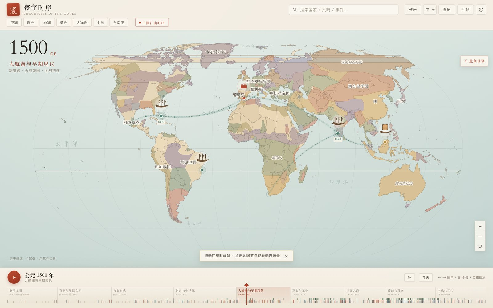
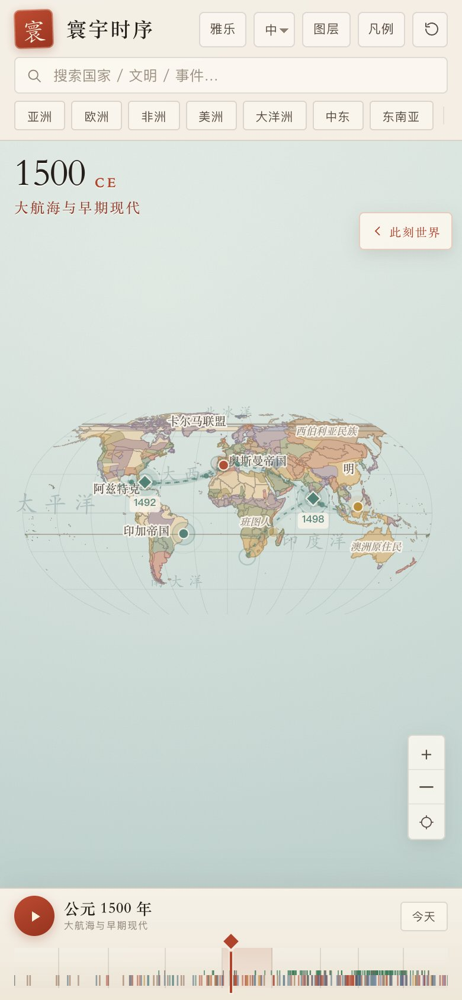
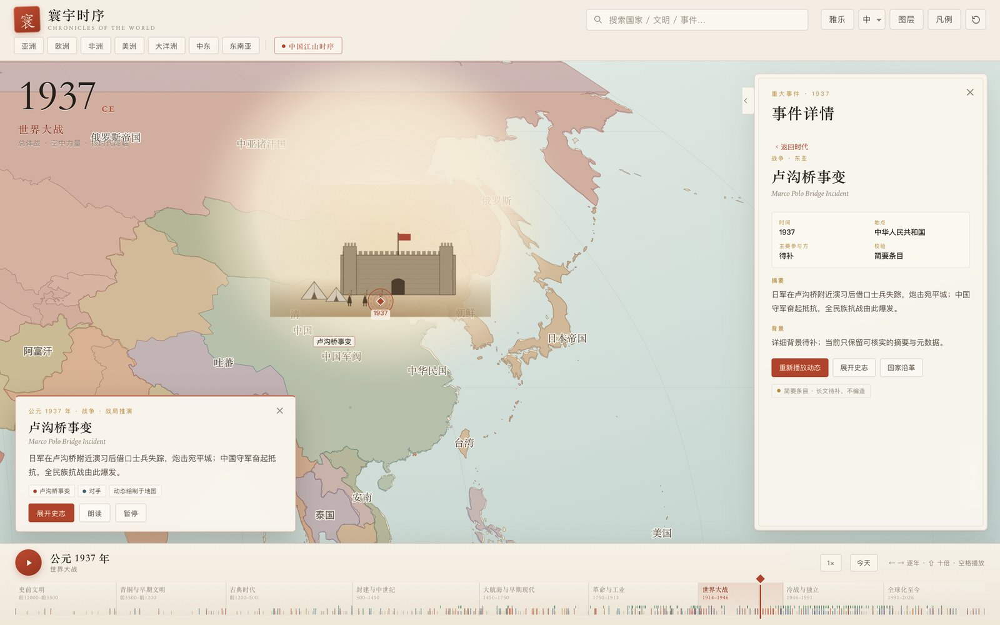
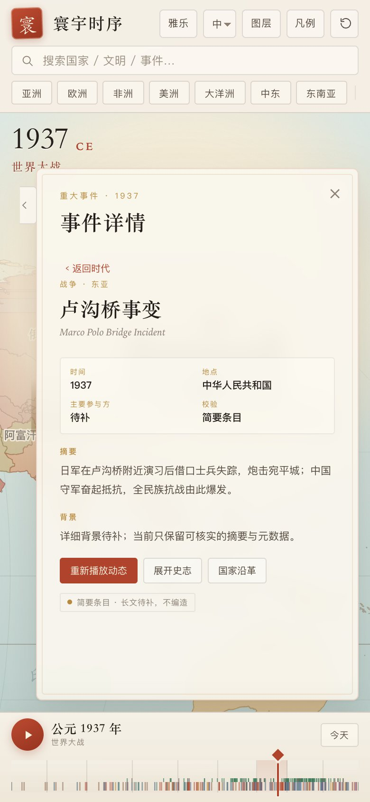

# 界面与交互复审 / UX Review

Date 2026-11-07. Scope: 寰宇时序主界面（桌面 1440×900、手机 390×844），包括时间轴、节点、搜索、侧栏、事件剧场与图例。方法：截图走查 + 真实交互测试（Playwright）+ 代码核对。

## 0. 结论摘要

整体气质是**一张可以走进去的羊皮纸世界地图**：字体、配色、纸纹、时代带和节点徽章形成了统一而少见的视觉语言，第一眼辨识度很高。但交互层仍停留在“展示型地图”而不是“可检索、可精确定位的历史工具”：

1. **时间轴只能拖，不能精确输入**；19 世纪在手机上 1px≈3.7 年，“逐年”提示与实际步长不符。
2. **事件信息出现三重表面**：地图浮动卡、右侧详情栏、事件剧场；互相重复、互相遮挡。
3. **历史标签不随年份收敛**：1937 年同时出现“清”“中国军阀”“中华民国”，数据源年限过宽。
4. **节点在低缩放时太小、无聚合、无分类筛选**；欧洲等密集区标签互相压盖。
5. **手机端地图占比小、标签与时间轴刻度不可读**，事件详情几乎全屏遮住场景。

## 1. 关键证据

### 1.1 时间轴精度

时代带按 `weight` 分配（总权重 106）。以桌面约 1400px 轨道计算：

| 区间 | 权重 | 年数 | 桌面 px/年 | 手机 390px px/年 |
|---|---:|---:|---:|---:|
| 1750–1913 | 12 | 163 | ~0.97 | ~0.27（1px≈3.7 年） |
| 1914–1946 | 9 | 32 | ~3.7 | ~1.0 |
| 1991–2026 | 11 | 35 | ~4.1 | ~1.1 |

- 键盘步长是 `100/25/10/5/1`（按年代自适应）：在 1500 年按两次右箭头实际 +10 年，但界面提示写“← → 逐年”。
- 时间轴没有年份输入、没有缩放/刷选、没有 hover 年份提示、没有“吸附到最近事件”。
- 播放头菱形与时代带文字同一水平线，密集时会压住时代标签。

### 1.2 搜索

- 结果列表可用：输入“卢沟桥”得到“卢沟桥事变 · 1937”。
- 点击结果只把年份设为 1937 并打开右侧详情栏，**不会播放地图剧场、也不打开事件剧场**（实测 `MapTheatre.active=false`、`modal=false`）。用户会以为“点了没反应”。
- 结果项无键盘上下选择/回车打开；搜索是发现事件的主要入口，却没有承担“定位并打开”的完整动作。

### 1.3 历史标签

- 1937 年视图同时出现“清”“中国军阀”“中华民国”。
- 数据源 `historical_entities.json` 中：`hist-manchu-empire-1620` 年限 **1620–1994**，`hist-chinese-warlords-1858` 年限 **1858–2018**；这些 basemap 标签年限过宽，且优先级低于 curated 实体但仍会显示。
- 事件详情里“地点”直接写“中华人民共和国”（1937 年事件），应改为“今地 / 当时政权”双行或至少加“今”。

### 1.4 事件表面

- 点击节点后：地图上出现浮动事件卡（标题、摘要、标签、展开/朗读/暂停），右侧同时打开“事件详情”长栏；再点“展开史志”进入全屏剧场。三层信息重复。
- 手机端右侧详情栏从 360px 一直铺到 1420px，几乎遮住整张地图与剧场卡；关闭只能点 ×/返回。

## 2. 设计层面的问题

### 2.1 信息层级

- 年份与地图是绝对主角，**事件是附属**；但产品叙事是“点击节点进入时刻”。应把“当前时刻发生了什么”提升为与年份同级的第二信息层（例如时间轴上方的事件带、或右侧常驻的时代+事件列表）。
- 右侧面板默认关闭，只留一个“此刻世界”小标签；新用户不知道那里有内容。首次进入应默认展开时代摘要，或在节点点击时以动效明确指向面板。

### 2.2 颜色与图例

- 政权色是大量低饱和粉彩，没有图例说明“颜色代表什么”（地区？政权？随机？）。“凡例”只解释时代，不解释政权色与事件类别色。
- 事件类别（战争/政制/商贸/信仰…）只在标签文字里出现，没有颜色/图标编码，难以扫读。

### 2.3 文字与密度

- 时代带标签约 10px，手机不可读；地图标签 10–11px，密集区压盖。
- 面板正文在手机上偏小、行宽过长；标题“事件详情”占据大量首屏空间，事件名反而在第二行。
- 时间轴刻度极密（498 事件的 tick），视觉噪声大，且没有 hover 反馈。

## 3. 分优先级建议

### P0（下一轮必须做）

1. **时间轴精确化**
   - 年份可点击/输入：点年份数字变成数字输入或 +/- 步进；支持“跳到年份”。
   - 细调：Alt/Shift+滚轮或拖拽时按住修饰键进入 1 年精度；把“逐年”文案改成真实行为，或默认 1 年。
   - hover/scrub 提示：鼠标在轨道上显示“年份 + 最近事件”；点击事件 tick 直接打开该事件。
   - 事件吸附：拖动时在 ±6px 内吸附到最近事件 tick，并高亮。
   - 为 1750–2026 提供“放大时间轴”（双击时代带或范围刷选），解决手机 1px≈4 年。
   - 播放头与时代标签分层，避免互相压字。

2. **历史标签按年份收敛**
   - basemap 标签在存在 curated 同区实体时降权/隐藏；把已知结束年（清 1912、军阀 1928）写入数据或 UI 端 clamp。
   - 标签碰撞检测 + 优先级 + 缩放 LOD；欧洲等密集区只显示前 N 个。
   - 事件地点改为“今 … / 当时 …”，避免 1937 年写“中华人民共和国”。

3. **统一事件表面**
   - 右侧面板作为唯一“详情”表面；地图浮动卡降级为一行“标题 + 查看/播放”，且面板打开时自动收起。
   - 手机端改为底部抽屉（三档高度：peek / half / full），保留地图与场景可见；抽屉内再滚动。
   - 点击节点 → 面板打开并播放地图剧场；“展开史志”才进入全屏剧场。

### P1（随后）

4. **节点可发现性**：低缩放下聚合/抽稀；徽章最小触控 44px（视觉可小、热区要大）；按类别筛选（战争/政制/商贸/信仰/科技…）；hover 预览标题/年份。
5. **搜索闭环**：结果项支持 ↑↓/Enter；点击结果同时定位年份、打开面板并播放剧场；搜索结果分组显示“事件/政权/文明”。
6. **手机布局**：地图占可视高度约 55–65%，减少上下空白；时间轴保留年份读数与时代色带但隐藏小字；区域导航加渐隐边缘提示可横滑。
7. **面板信息架构**：顶部“时代摘要 + 筛选”，中部“事件列表”，选中后替换为“事件详情 + 返回”；默认展开一次。
8. **引导与图例**：首次进入 3 步引导（拖时间 / 点节点 / 搜索）；“中国江山时序”加一句说明；凡例补事件类别与政权色说明；快捷键面板（?）。
9. **无障碍**：时间轴 `role="slider"` + `aria-valuetext`（年份）；节点可 Tab 聚焦；焦点环；正文 ≥13px、地图标签 ≥11px；对比度检查；`prefers-reduced-motion` 时降低粒子/动画。

### P2（打磨）

10. 时代带 tick 抽稀/分层（按缩放只画主要事件）；播放头动效；面板滚动条更明显；空状态与加载态；多语言长文本回归；地图 HUD 在浅色陆地加纸底/阴影保证对比。

## 4. 建议实施顺序

1. P0-1 时间轴精确化（app.js `timeline` / track 交互 / keyboard）。
2. P0-2 标签收敛（historical entities 优先级、碰撞、地点文案）。
3. P0-3 事件表面统一（app.js panel/card/modal 状态机、移动端抽屉）。
4. P1 节点聚合/筛选、搜索闭环、手机布局。
5. 回归验证：499 事件、56 家族、32 Hero、29 变体、16 秒清理、390×844、60fps、LOD、战斗上限 16、台湾省、面板滚动。
6. 之后再继续内容侧：审计偏薄区（中亚诸汗国、前哥伦布美洲、东南亚早期现代、当代南亚/拉美）与 56 家族夜空/夜景基线暖色化。

## 5. 交接说明

- 本复审只做分析与建议，未改代码。
- 新会话请先读本文件、`docs/hero-roadmap.md`、`docs/world-audit-and-dynamics.md`、`docs/qa-and-limitations.md`。
- 主战场：`js/app.js`（时间轴、搜索、面板、键盘）、`js/theatre.js`（标签/剧场）、`data/historical_entities.json`（标签年限）、`css/style.css`（移动端/焦点/字号）。
- 每个 pass 完成后本地提交并做完整回归；推送由用户在 GitHub Desktop 完成。
