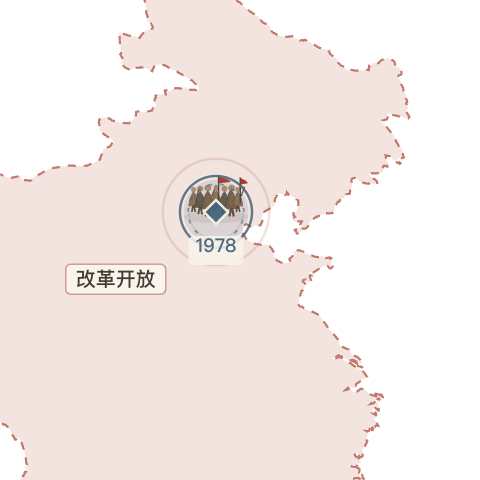
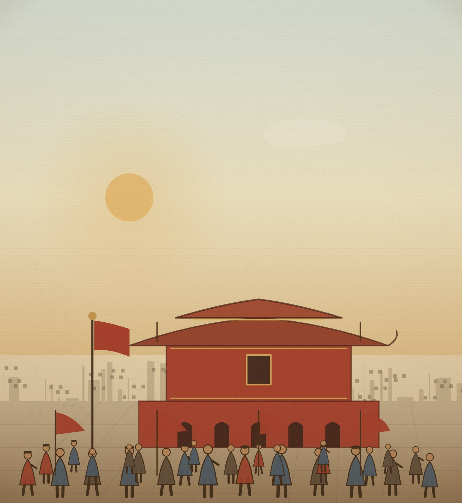
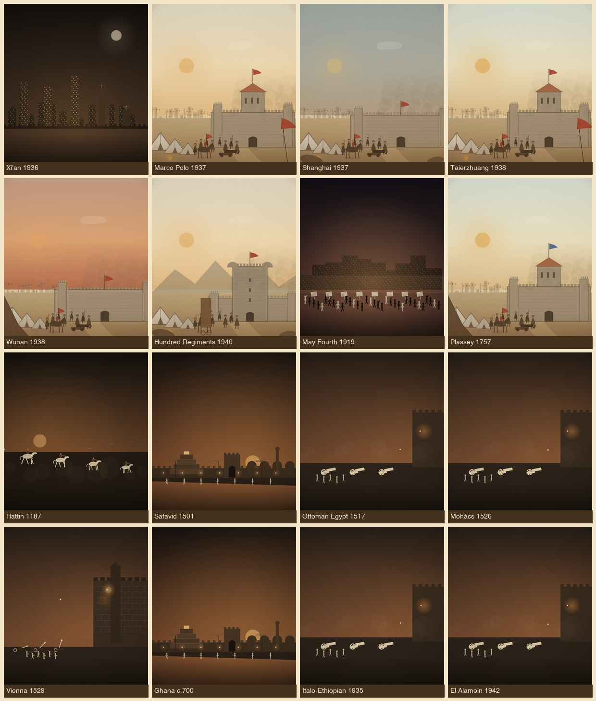

# 世界节点审计与剧场动态修正（2026-11-07）

本次回应三类问题：地图关键节点的“人绕圈”动态、1949 建政场景不符合中国语境、以及全球关键节点缺漏（用户点名 1937 卢沟桥与 1931 九一八）。

## 1. 地图剧场动态

**问题**：civic 模式的 `battles[{kind:"crowd"}]` 会为两侧各生成 2 个 `crowd` 单位，围绕事件点做整圈公转，形成“一坨人在转圈”。战斗单位同样绕点公转。

**修正**（`js/theatre.js`）：

- `buildUnits` 跳过 `kind:"crowd"`，不再生成绕圈人群；人群由 `drawCrowd` 单独绘制。
- 所有无路径战斗单位改为**原地列阵 + 轻微摆动**（`sin` 幅度 0.05），不再公转。
- `drawCrowd` 重做：7 个错落人物（袍服、举手、儿童身高差）、两面旗帜、地面阴影与少量欢呼光点；配合事件脉冲环，读作“聚集”而不是“环绕”。
- 1978 改革开放徽章修正后：

## 2. 1949 建政舞台

原 `peoples-republic-of-china` 使用通用 `revolution` 夜景（西式立面 + 街垒），不符合中国语境。现改为 Tier B `modern` 家族的 `tiananmen` 结构：

- 红墙 + 五座拱门、门楼、金色边框画像、重檐屋顶与脊兽、红旗、广场人群。
- 场景仍走参数化变体引擎，不新增 Hero 计数。
- 图像：

## 3. 全球节点审计

### 3.1 已存在、此前不易发现的节点

- **1931 九一八事变**（`mukden-incident`）已在数据中；本次为它补 Tier B 围城变体，地图可读性提升。
- 1937 南京大屠杀、1945 日本投降/中国战区受降等均在库。

### 3.2 本次新增（16 个）

| 年份 | 事件 | 地区 | 说明 |
|---:|---|---|---|
| 700 | 加纳帝国兴起 | 西非 | 跨撒哈拉黄金/食盐贸易的第一个西非大帝国 |
| 1187 | 哈丁战役 | 中东 | 萨拉丁歼灭十字军主力，收复耶路撒冷 |
| 1501 | 萨非王朝建立 | 中东 | 十二伊玛目派成为国教，近代伊朗格局 |
| 1517 | 奥斯曼征服埃及 | 中东 | 灭马穆鲁克，控制红海与东地中海商路 |
| 1526 | 莫哈奇战役 | 欧洲 | 匈牙利被分割，奥斯曼深入中欧 |
| 1529 | 维也纳之围 | 欧洲 | 奥斯曼中欧扩张的极限 |
| 1757 | 普拉西战役 | 南亚 | 东印度公司取得孟加拉，英属印度起点 |
| 1919 | 五四运动 | 东亚 | 新文化运动与民族觉醒的转折 |
| 1936 | 西安事变 | 东亚 | 停止内战、联共抗日，统一战线初步形成 |
| 1937 | 卢沟桥事变 | 东亚 | 全民族抗战爆发 |
| 1937 | 淞沪会战 | 东亚 | 粉碎日军速战速决，三个月血战 |
| 1938 | 台儿庄战役 | 东亚 | 正面战场早期重要胜利 |
| 1938 | 武汉会战 | 东亚 | 战争转入长期相持 |
| 1940 | 百团大战 | 东亚 | 华北破袭战，打击“囚笼政策” |
| 1935 | 第二次意埃战争 | 非洲 | 国联制裁失败，法西斯扩张 |
| 1942 | 第二次阿拉曼战役 | 非洲 | 北非战局转折 |

新增后：**498 个事件 / 56 个家族 / 0 条分派错误**；`data/scene_variants.json` 已重新生成，Hero 32 与 Tier B 覆盖不变。新增战争节点多数接 Tier B 围城变体，避免落入通用夜景。

### 3.3 仍偏薄、建议下一轮补的节点

- **早期中世纪非洲**：加纳已补；卡涅姆-博尔努、斯瓦希里城邦仍缺。
- **中亚**：帖木儿（1370）、察合台汗国、喀喇汗国等。
- **东南亚早期现代**：马六甲陷落（1511）、亚齐苏丹国。
- **当代南亚/拉美**：1998 印巴核试验、2008 孟买袭击、拉美粉红浪潮等（部分涉及敏感题材，需按现有 1945 纪念性处理原则）。
- **中东早期现代**：萨非/奥斯曼已补，仍可加 1534 巴格达、1578 骑兵战役等。

## 4. 验收

- 498/498 事件通过 `validate-data`；56 家族 0 分派错误；`build-data`、`node --check` 通过。
- 16 个新增节点 stage 渲染、0 报错；1931/1937 等地图剧场可打开。
- 1978 徽章 `units=[]`（不再绕圈），`drawCrowd` 与脉冲环正常。
- 1949 走 `tiananmen` Tier B 变体，`MapTheatre.variant` 正确设置/清理。
- 32 个 Hero 场景与既有回归项（16 秒清理、390×844、60fps、LOD、战斗上限 16、台湾、面板）保持通过。
